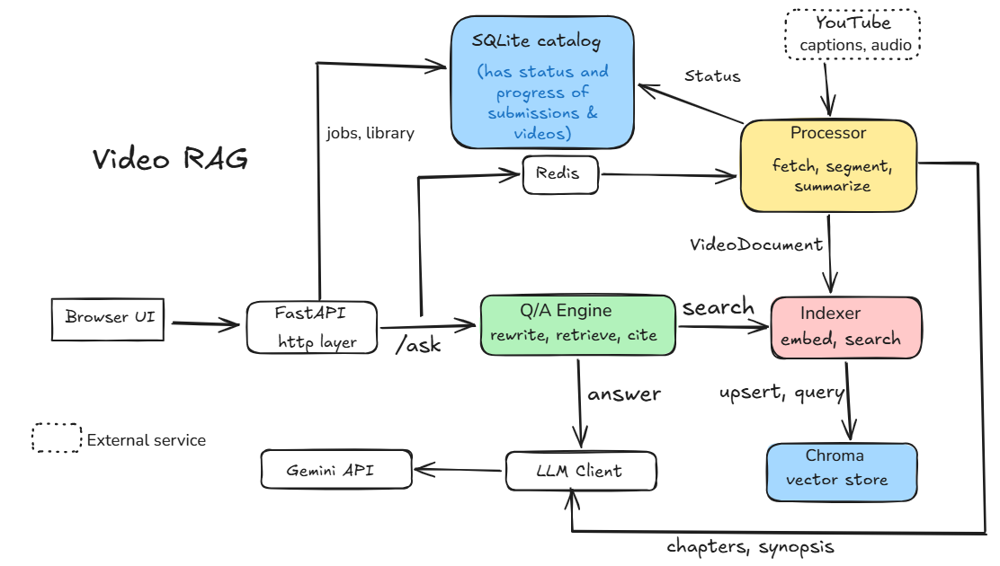

# Video RAG

User pastes a YT URL and gets chapters with timeframes, synopsis and the ability to ask any question about the video. 
 
Answers cite timestamps, and clicking a timestamp jumps the embedded player to that moment.

## What will be implemented

<li>Submit a YouTube URL, validate it, and derive the video_id. </li>

<li>Async processing with job status and per-stage progress, persisted in SQLite. </li>
 
<li>Transcript acquisition: manual YouTube captions first, then auto-generated captions, then audio download plus Whisper as fallback.</li>

<li>Transcript cleaning and segmentation into timestamped chunks</li>

<li>Chapter generation (title, timeframe, summary) and a global synopsis, computed once at index time, with server-side validation of chapter boundaries.</li>

<li>Embedding and indexing of segments in a vector database, idempotent by video_id.</li>
 
<li>Open-ended Q&A over the video: conditional question rewriting, retrieval, grounded answers, server-mapped timestamp citations, and an explicit 'not covered in the video' response.</li>

<li>A provider-agnostic LLM layer with rate limiting, retries, and JSON-schema output (Gemini).</li>
 
<li>A single-page web UI: URL input, progress view, player, synopsis, chapters, chat, and the library with delete.</li>

<li>Persistent library: every processed video stays stored and indexed, is listed in the UI, and reopens instantly. Re-submitting a processed URL returns the stored result.</li>
 
<li>A minimal evaluation harness that scores retrieval, citations, and refusals against a hand-written question set.</li>

## Architecture Diagram

